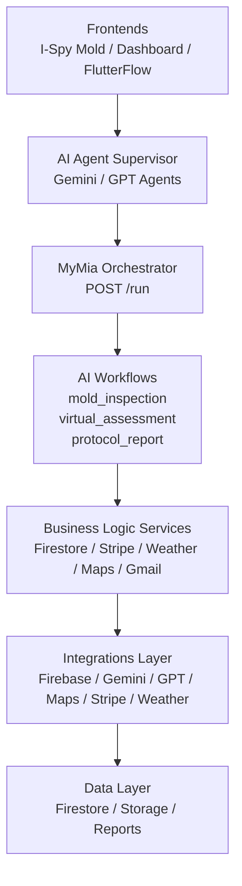

# MyMia Backend — Unified AI Orchestrator Platform

One endpoint. Any app. Infinite workflows.

MyMia is a multi-app, AI-driven backend powering I-Spy Mold, MyMia Dashboard, and future products.

> 🔥 AI-native orchestration platform that separates reasoning (LLMs) from deterministic, auditable business logic.

---

## Table of Contents
- [Introduction](#introduction)
- [Architecture](#architecture)
- [Goals & Guarantees](#goals--guarantees)
- [Core Components](#core-components)
- [Local Development & Configuration](#local-development--configuration)
- [API & Response Standards](#api--response-standards)
- [Security & Standards](#security--standards)
- [Folder Structure](#folder-structure)
- [Deployment](#deployment)
- [Observability & Testing](#observability--testing)
- [Contributing & Support](#contributing--support)
- [License](#license)

---

## Introduction

MyMia is a next-generation backend architecture designed for AI-native, multi-application platforms. It powers:

- I-Spy Mold (consumer-facing)
- MyMia Dashboard (internal + enterprise)
- Future property inspection and environmental intelligence tools

MyMia enables:

- Multi-step AI workflows (Gemini Vision, GPT-5, Gemini Video)
- Stable, secure business logic & integrations
- Multi-tenancy for users, jobs, and organizations
- Consistent front-end development across apps (Mobile, Web, FlutterFlow)

---

## Architecture

MyMia offloads reasoning to AI but keeps execution secure and deterministic. The platform ensures security and scalability through deterministic routing and execution.



---

## Goals & Guarantees

- **Unified API** — One endpoint (`POST /run`) powers every feature across all MyMia products.
- **Infinite AI Workflows** — New workflows are created in minutes without adding endpoints.
- **Safety First** — No LLM ever writes to Firestore, Storage, or Stripe directly. The Orchestrator delegates sensitive actions only to trusted Services.
- **Frontend-Agnostic** — Any client that can POST JSON can use the platform.
- **AI-Native** — Gemini and OpenAI models operate as first-class workflow participants.

---

## Core Components

### Orchestrator
Located at: `app/orchestrator.py`.

Responsibilities:

- Request validation
- Firebase token extraction
- Context building (`user_id`, `job_id`, `org_id`)
- Workflow routing and step-by-step execution
- Robust state management
- Delegation to services
- Final JSON response assembly

### AI Workflows
Workflows define “how to think.” They are multi-step sequences combining AI reasoning and Service calls.

Workflows live in: `app/workflows/`

Example workflows:

- `mold_inspection` — Vision → Moisture → Protocol (Gemini Vision + GPT-5)
- `virtual_assessment` — Video-based property inspection (Gemini Video)
- `protocol_report` — Remediation protocol writing (GPT-5)
- `moisture_mapping` — Moisture pattern extraction (Gemini Vision)
- `invoice_summary` — Billing + Stripe pipeline (GPT-5)
- `email_summary` — Gmail → summary → next-action (Gemini/GPT)
- `job_classifier` — Categorization of job type (Gemini Pro)

### Services Layer
Location: `app/services/`.

Services contain deterministic business logic and are the only layer that writes to Firestore, Storage, or Stripe. AI reasoning never directly accesses these services.

### Integrations Layer
Location: `app/integrations/`.

Wrappers for external APIs: Firebase, Stripe, Google Maps, Tomorrow.io, Gmail, Calendar, OpenAI, Vertex AI, etc.

### Data Layer
Firestore typed with Pydantic models in `app/models/`. Storage for media and generated reports.

---

## Local Development & Configuration

### Environment Variables
Create a local `.env` file with the required variables.

| Variable | Description |
|---|---|
| GOOGLE_PROJECT_ID | GCP Project ID for Firebase and Cloud Run |
| FIREBASE_API_KEY | Firebase Web API Key for client integration |
| STRIPE_SECRET_KEY | Stripe secret key for secure payments |
| GEMINI_API_KEY | API key for Vertex AI / Gemini models |
| OPENAI_API_KEY | API key for GPT-5/GPT-4.1 models |
| TOMORROW_IO_API_KEY | Weather data API key |
| LOG_LEVEL | Logging verbosity (e.g., INFO, DEBUG) |

### Quickstart (Local)

1. Install dependencies

```bash
pip install -r requirements.txt
```

2. Create and populate `.env`

3. (Optional) Run Firebase Local Emulator

Start the Firebase Local Emulator Suite (Auth/Firestore/Storage) to simulate the data layer without hitting production.

4. Run API

```bash
uvicorn app.main:app --reload --host 0.0.0.0 --port 8000
```

---

## API & Response Standards

All API responses from the `POST /run` endpoint follow a consistent JSON format.

### Sample Success Response

```json
{
  "status": "success",
  "workflow": "mold_inspection",
  "data": {
    "job_id": "job-10293",
    "risk_level": "moderate",
    "protocol_summary": "Generated remediation protocol PDF is available at gs://...",
    "steps_executed": 5
  },
  "metadata": {
    "request_id": "uuid-9012-...",
    "duration_ms": 4500
  }
}
```

### Sample Error Response

```json
{
  "status": "error",
  "code": "WORKFLOW_EXECUTION_FAILURE",
  "message": "Step 'moisture_mapping' failed: Vision service timeout."
}
```

---

## Security & Standards

### Security

- Firebase JWT validation is performed on every `/run` request.
- Firestore and Storage rules enforce user and tenant data isolation.

### Rate Limiting

Rate limiting is applied at the API Gateway layer (GCP Cloud Endpoints or Cloud Armor) to protect the Orchestrator and underlying services from abuse.

### Versioning

We use Semantic Versioning (SemVer) for releases.

Branching:

- `main` - Production
- `dev` - Staging
- `feature/*` - Feature development

---

## Folder Structure

```
/app
  main.py
  orchestrator.py
  /workflows
  /services
  /integrations
  /prompts
  /models
  /utils
  /actions (optional legacy)
firestore.rules
storage.rules
deploy/
Dockerfile
cloudrun.yaml
.github/workflows/
README.md
README.dev.md
```

---

## Deployment

### Google Cloud Run

```bash
# Build the Docker image
gcloud builds submit --tag gcr.io/PROJECT/mymia

# Deploy to Cloud Run
gcloud run deploy mymia --image gcr.io/PROJECT/mymia
```

### CI/CD

Automated deployment via GitHub Actions (`.github/workflows/deploy.yml`). It supports tests, linting, and canary rollouts.

---

## Observability & Testing

### Logging & Monitoring

- Cloud Logging: All service logs are ingested by Google Cloud Logging.
- Trace IDs: Every request gets a unique Request ID propagated across internal calls.
- Metrics: Workflow execution times are logged (see `app/utils/logging.py`).

### Testing Strategy

- Unit Tests: Deterministic service logic using pytest, mocking external dependencies.
- LLM Mocks: All calls to `ai_service.py` must be mocked to avoid external costs.
- Integration Tests: Use Firebase Emulator to validate state transitions and steps.

Run tests:

```bash
pytest
```

---

## Contributing & Support

For engineering questions, contact the MyMia backend team or open a GitHub issue. Include logs, request IDs, and a short description of the problem to speed up troubleshooting.

---

## License

Add your project license here.
